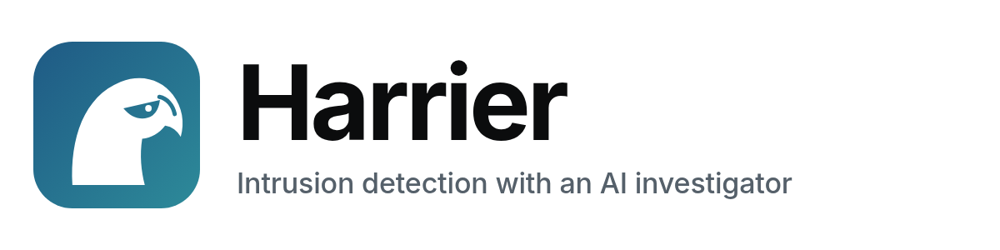

<p align="center">
  <picture>
    <source media="(prefers-color-scheme: dark)" srcset="docs/logo/harrier-logo-dark.png">
    
  </picture>
</p>

<p align="center">
  Self-hosted intrusion detection for your home network and the services you run on it.<br>
  Rules catch attacks, a local AI investigates them, and nothing an attacker writes can talk it out of a block.
</p>

---

Harrier watches your web server, SSH, firewall, every device's DNS and this machine's connections.
It blocks clear-cut attacks on its own, and a local AI (via [Ollama](https://ollama.com)) writes up
every incident in plain language and recommends a response. Your own domains are checked from
outside for hijacking, defacement and look-alike phishing sites, wherever they're hosted.

Everything runs on your machine: no cloud service, no telemetry.

## What it does

- **Detects** probing for secrets and admin panels, exploit strings (Log4Shell, SQL injection,
  path traversal), password guessing on web, SSH and the dashboard itself, port scans, and
  attack tools.
- **Spots coordinated attacks.** Botnets and AI-agent swarms that split the work across many
  addresses become one incident, and every address in it is blocked.
- **Can't be talked out of a block.** Text in traffic aimed at an AI ("ignore your instructions",
  "the owner approved this scan") is treated as an attack in its own right. The AI can only add or
  lengthen blocks; unblocking and permanent blocks always need a person.
- **Watches home devices** through Pi-hole: malware-style random domains, data smuggled out through
  DNS, clockwork check-ins to new domains, and new devices joining.
- **Watches this machine's connections:** containers calling out on suspicious ports, contact with
  known attackers, and a machine on your network scanning others.
- **Watches your domains from outside:** DNS and nameserver changes, page-title changes,
  certificate problems, downtime, and new certificates for look-alike names.
- **Learns, carefully.** From your decisions and from confirmed attackers only, never from what
  traffic says. New patterns must come from at least two attackers and never appear in normal
  traffic.
- **Tests itself:** live checks every 6 hours, a 59-test replay suite nightly, and an AI red team
  weekly, all shown in the dashboard.
- **Accounts:** admins and read-only viewers, Argon2 password hashing, revocable sessions,
  lockouts, and full sign-in history.

## Minimum system requirements

| | Minimum | Recommended |
|---|---|---|
| **OS** | 64-bit Linux (x86_64 or arm64) with nftables and conntrack: Ubuntu 22.04+, Debian 12+ or similar | |
| **Docker** | Docker Engine 24+ with Compose v2 | |
| **Harrier itself** (Postgres, web, sensors) | 2 CPU cores, 2 GB RAM, 5 GB disk | 4 cores, 4 GB RAM, 20 GB SSD |
| **AI on CPU** (bundled Ollama, 4–8B model) | 4 cores, 12–16 GB RAM, +5 GB disk. About 30–90 s per investigation | |
| **AI on GPU** | NVIDIA with 6 GB VRAM (7–8B model) + NVIDIA Container Toolkit | **12 GB VRAM** for the default `gemma4:12b`: about 10–20 s per investigation |
| **Sharing an existing Ollama** | Nothing extra here. Harrier uses yours and doesn't start another | |

Notes:
- **Blocking needs Linux.** Harrier must run on the machine that serves your apps (its firewall
  rules sit in front of Docker). On other systems it can watch but not block.
- **The AI is optional.** With it switched off, rules still detect and block. You just don't get
  write-ups.
- **Tested on:** x86_64 Linux with an RTX 3060 (12 GB) and `gemma4:12b`. arm64 and Raspberry Pi
  (Pi 5, 8 GB, with a small model or a remote Ollama) should work but are untested.

## Quick start

```bash
git clone https://github.com/amukherjee1991/harrier.git
cd harrier
./setup.sh
```

`setup.sh` checks Docker and creates `.env` with generated passwords. It then **looks for an
Ollama that's already running**, in Docker or directly on the machine, and shares it. It only
starts the bundled Ollama when none is found. It also suggests a model that fits your hardware,
starts everything, and prints your admin sign-in.

Open **http://localhost:8095** and sign in.

### Feeding it logs

| Source | How |
|---|---|
| Web traffic | Add the snippets from [`docs/Caddyfile.example`](docs/Caddyfile.example) to your Caddy config and set `CADDY_LOG_DIR` |
| SSH and firewall | Read from `/var/log` automatically (`auth.log`, `ufw.log`) |
| Home devices | Set `PIHOLE_URL` and `PIHOLE_PASSWORD` (Pi-hole v6) |
| Connections | Automatic (the `harrier-flows` container) |
| Your domains | Set `DOMAINS`, and optionally `BRAND_KEYWORD` for look-alike alerts |

Every setting is documented in [`.env.example`](.env.example). Most can be changed later in
**Settings**.

### Choosing a model
Any Ollama model that supports JSON output works. Pick or download one in **Settings → AI model**;
downloads go into whichever Ollama Harrier is using. After switching, run the **AI red team** under
**Health** to see how the new model holds up against manipulation attempts.

## How it works

```
 Caddy log ─┐                    ┌─ rules ──────── block (time-limited) ─┐
 SSH, ufw ──┤                    │                                        ▼
 Pi-hole ───┼─► signals ─► incidents ─► AI investigator ─► recommend ─► harrier-guard ─► nftables
 conntrack ─┤                    │        (Ollama)          (code decides what it may do)
 domains ───┘                    └─ coordinated-attack detection (many addresses, one pattern)
```

- **`harrier`** runs the web dashboard, the sensors, correlation, the AI investigator, the domain
  watch, learning and the self-checks.
- **`harrier-guard`** turns the block list into an nftables table hooked before Docker. It never
  handles attacker text or talks to the AI.
- **`harrier-flows`** records connections from conntrack.
- **Postgres** holds all of it.

Home, VPN, private ranges, your public IP and your allowlist can never be blocked, by anything.

## Security model

- Traffic is evidence, never instructions. Attacker text is defanged before it reaches the model,
  and manipulation attempts are flagged by rules regardless of what the model says.
- The AI's output is limited to a fixed set of actions. Code decides which are allowed: only adding
  or lengthening blocks, never on protected addresses, never permanent without a person.
- Dashboard: Argon2id passwords, random session tokens stored only as hashes, HttpOnly SameSite
  cookies, account lockout and per-address throttling, a strict Content Security Policy, and
  read-only viewers. Failed sign-ins feed Harrier's own detection.
- Harrier defends; it never attacks back.

## Testing

```bash
./deploy.sh                    # rebuild, run all tests against Postgres, restart only if they pass
./tests/selftest.sh            # live checks of the running system
bash tests/attack.sh your.domain   # from OUTSIDE your network: attack your own site and time the block
```

## Upgrading from a pre-1.0 (SQLite) Harrier

```bash
./setup.sh --import /path/to/old/data/harrier.db
```

Incidents, blocks, learned patterns, device baselines and history come across.

## Uninstall

```bash
docker compose down                      # stop (data stays in ./data)
docker exec harrier-guard nft delete table inet harrier   # remove all firewall blocks immediately
```

## License

[MIT](LICENSE) © 2026 Arghya Mukherjee
